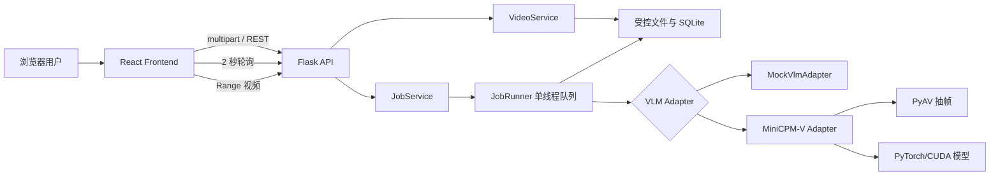
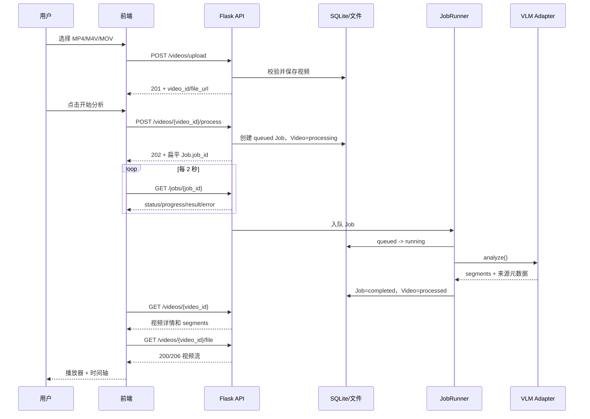

# 学生学习状态分析系统项目总说明

> 文档版本：2026-10-28  
> 对应项目根：`E:\dachuang\System-Intergration`  
> 前端目录：`E:\dachuang\System-Intergration\frontend`  
> 后端目录：`E:\dachuang\System-Intergration\backend`

本文档只描述当前代码和已经实际验证的能力。Mock、真实模型、尚未实现的功能和环境未满足的部分会被明确区分。

## 目录

1. [项目简介](#1-项目简介)
2. [技术栈](#2-技术栈)
3. [完整目录树](#3-完整目录树)
4. [文件功能说明](#4-文件功能说明)
5. [系统架构](#5-系统架构)
6. [核心业务流程](#6-核心业务流程)
7. [接口说明](#7-接口说明)
8. [首次使用指南](#8-首次使用指南)
9. [基本功能说明](#9-基本功能说明)
10. [配置说明](#10-配置说明)
11. [常见问题排查](#11-常见问题排查)
12. [目录重命名说明](#12-目录重命名说明)
13. [测试和验证结果](#13-测试和验证结果)
14. [当前限制](#14-当前限制)
15. [旧文档与最终代码的差异](#15-旧文档与最终代码的差异)

---

## 1. 项目简介

本项目用于在本地环境中完成短视频上传、异步分析任务、VLM 场景识别和视频时间轴展示。系统解决的是“视频文件分散、分析过程不可观察、结果无法和播放位置对应”的问题。

当前闭环：

```text
选择本地视频
  -> multipart 上传
  -> 创建异步分析任务
  -> 每 2 秒轮询任务
  -> 读取场景 Segment
  -> 播放视频并联动时间轴
```

后端支持两种实现：

- `mock`：默认模式，不加载模型，用于验证 API、任务状态机和前端展示；
- `minicpm`：真实 MiniCPM-V 4.6 逐帧分类实现，需要 CUDA、PyTorch、Transformers 和本地模型权重。

当前已经实现并验证了 Mock 全链路、可播放视频处理、任务轮询、Range 文件访问、结果导出和前端时间轴。真实 MiniCPM-V 推理代码存在，但当前环境没有完成运行验收。

## 2. 技术栈

### 2.1 前端

依赖来源：`frontend/package.json` 和 `package-lock.json`。

| 技术 | 当前声明/锁定 |
|---|---|
| React | 18.3.x |
| React DOM | 18.3.x |
| TypeScript | 5.x，锁定 5.9.3 |
| Vite | 5.x，锁定 5.4.21 |
| Zustand | 5.x，锁定 5.0.16 |
| Ant Design | 5.x，锁定 5.29.3 |
| Axios | 1.x，锁定 1.20.0 |
| 包管理 | npm，Node >=18，npm >=9 |

### 2.2 后端

依赖来源：`backend/requirements.txt`。

| 技术/依赖 | 当前版本或说明 |
|---|---|
| Python | 3.12 |
| Flask | 3.1.3 |
| pytest | 9.1.1 |
| Pillow | 10.4.0 |
| numpy | 1.26.4 |
| PyAV | 19.0.2 |
| SQLite | Python 标准库 `sqlite3` |
| 真实 VLM | MiniCPM-V 4.6，依赖外部 torch/transformers/CUDA 环境 |

真实 VLM 的 PyTorch、torchvision、Transformers 版本没有放入通用依赖文件，因为这些包的安装源和版本必须匹配实际 CUDA 主机。

## 3. 完整目录树

以下结构排除 `.git/`、`node_modules/`、`.venv/`、`backend/var/`、`dist/`、`__pycache__/`、测试缓存和模型权重。

```text
System-Intergration/
├── .gitignore
├── README.md
├── backend/
│   ├── .env.example
│   ├── .gitignore
│   ├── README.md
│   ├── requirements.txt
│   ├── pytest.ini
│   ├── app.py
│   ├── config.py
│   ├── logging_setup.py
│   ├── adapters/
│   │   ├── __init__.py
│   │   └── vlm/
│   │       ├── __init__.py
│   │       ├── base.py
│   │       ├── frames.py
│   │       ├── minicpm.py
│   │       ├── mock.py
│   │       └── scene.py
│   ├── api/
│   │   ├── __init__.py
│   │   ├── errors.py
│   │   ├── jobs.py
│   │   ├── params.py
│   │   ├── system.py
│   │   └── videos.py
│   ├── common/
│   │   ├── __init__.py
│   │   └── timeutil.py
│   ├── schemas/
│   │   ├── __init__.py
│   │   ├── enums.py
│   │   ├── job.py
│   │   ├── segment.py
│   │   └── video.py
│   ├── services/
│   │   ├── __init__.py
│   │   ├── errors.py
│   │   ├── export_service.py
│   │   ├── job_service.py
│   │   ├── media_probe.py
│   │   ├── task_runner.py
│   │   └── video_service.py
│   ├── storage/
│   │   ├── __init__.py
│   │   ├── db.py
│   │   ├── files.py
│   │   └── repositories.py
│   └── tests/
│       ├── assertions.py
│       ├── conftest.py
│       ├── media_fixtures.py
│       ├── video_fixtures.py
│       ├── test_config.py
│       ├── test_frames.py
│       ├── test_job_runner.py
│       ├── test_jobs_api.py
│       ├── test_media_probe.py
│       ├── test_minicpm_adapter.py
│       ├── test_mock_adapter.py
│       ├── test_real_vlm_optional.py
│       ├── test_results_api.py
│       ├── test_scene_parse.py
│       ├── test_segment.py
│       ├── test_storage.py
│       ├── test_system.py
│       └── test_videos_api.py
└── frontend/
    ├── .env.example
    ├── .env.local              # 本机文件，Git 忽略
    ├── .gitignore
    ├── PROJECT_GUIDE.md
    ├── README.md
    ├── index.html
    ├── package.json
    ├── package-lock.json
    ├── tsconfig.json
    ├── tsconfig.node.json
    ├── vite.config.ts
    ├── public/
    │   └── favicon.svg
    └── src/
        ├── App.tsx
        ├── main.tsx
        ├── index.css
        ├── vite-env.d.ts
        ├── api/
        │   ├── auth.ts
        │   ├── client.ts
        │   ├── history.ts
        │   ├── mock.ts
        │   └── videos.ts
        ├── assets/
        │   └── app-mark.svg
        ├── components/
        │   ├── AnalysisProgress.tsx
        │   ├── AppHeader.tsx
        │   ├── AuthModal.tsx
        │   ├── HistoryDrawer.tsx
        │   ├── TimelineViewer.tsx
        │   └── VideoUpload.tsx
        ├── hooks/
        │   └── usePollingJob.ts
        ├── mock/
        │   └── vlmSegments.ts
        ├── store/
        │   ├── useAppStore.ts
        │   └── useAuthStore.ts
        ├── types/
        │   └── index.ts
        └── utils/
            ├── format.ts
            └── sceneColors.ts
```

运行期会生成：

```text
backend/var/app.db
backend/var/app.db-wal / app.db-shm
backend/var/videos/
frontend/dist/
frontend/node_modules/
```

这些内容不应提交到 Git。

## 4. 文件功能说明

### 4.1 前端入口与页面

| 文件 | 具体职责 |
|---|---|
| `frontend/index.html` | Vite HTML 入口，提供 `#root`、页面标题、favicon 和 `/src/main.tsx` 模块入口。 |
| `frontend/src/main.tsx` | 将 React 应用挂载到 `#root`，导入 Ant Design reset 和全局样式。 |
| `frontend/src/App.tsx` | 页面总布局；组合上传、进度和时间轴组件；调用 `startVideoAnalysis()` 创建任务；把 `video.video_id` 传给轮询 Hook。 |
| `frontend/src/index.css` | 全局排版、背景、Ant Design 组件覆盖和响应式规则。 |

### 4.2 前端 API 与状态

| 文件 | 具体职责 |
|---|---|
| `src/api/client.ts` | 创建 Axios 实例；读取 API 前缀、超时和 Mock 开关；从统一错误体提取消息和 request ID。 |
| `src/api/videos.ts` | 封装上传、创建任务、查询 Job、查询视频；标准化 snake_case Segment；区分 0 与 null 置信度；处理结构化 Job 错误；按 Job 结果、视频顶层、旧 Mock 元数据顺序回退。 |
| `src/api/mock.ts` | 浏览器内模拟上传、任务状态推进和固定结果；Blob URL 提供本地视频预览；使用与真实 API 同构的 `video_id/job_id` 字段。 |
| `src/hooks/usePollingJob.ts` | 每 2000 ms 串行查询 Job；完成时读取视频详情；失败时提取 `error.message`；卸载时清理定时器。 |
| `src/store/useAppStore.ts` | Zustand 全局状态和动作，保存上传/分析进度、视频、视频 URL、Job ID、Segment 和错误。 |
| `src/types/index.ts` | 定义前端状态、Video、Job、JobError、原生 Segment、标准化 Segment 和 Mock 数据模型。 |

### 4.3 前端业务组件与资源

| 文件 | 具体职责 |
|---|---|
| `src/components/VideoUpload.tsx` | 文件选择和拖拽；按扩展名限制 MP4/M4V/MOV；调用上传 API；显示文件名、大小和上传进度。 |
| `src/components/AnalysisProgress.tsx` | 显示上传/分析进度、后端阶段文本、错误、Job ID 和开始/重新分析按钮。 |
| `src/components/TimelineViewer.tsx` | 渲染 `<video>`；监听 metadata、timeupdate、seeked 和 error；显示场景色块、当前场景、播放游标；点击场景时 seek 并播放。 |
| `src/mock/vlmSegments.ts` | 前端独立 Mock 使用的 5 个固定场景。 |
| `src/utils/format.ts` | 时间、百分比和文件大小格式化；null/undefined 置信度显示“未提供”。 |
| `src/utils/sceneColors.ts` | 根据场景标签选择颜色，未知标签使用稳定哈希配色。 |
| `src/components/AppHeader.tsx` | 简洁页头、本地处理状态和右上角账户入口。 |
| `src/components/AuthModal.tsx` | 本地账户登录与注册弹窗。 |
| `src/components/HistoryDrawer.tsx` | 当前登录用户的 Job 历史列表与结果打开入口。 |
| `src/api/auth.ts` / `src/store/useAuthStore.ts` | 账户接口和前端会话状态。 |
| `src/api/history.ts` | 个人历史查询。 |
| `src/assets/app-mark.svg` | 页头品牌图形。 |
| `public/favicon.svg` | 浏览器 favicon。 |

### 4.4 前端配置与依赖

| 文件 | 具体职责 |
|---|---|
| `package.json` | npm 包名、运行/构建脚本和直接依赖。无 `test`、`lint` 脚本。 |
| `package-lock.json` | npm 依赖锁定和实际解析版本。 |
| `vite.config.ts` | React 插件、`@` alias、5173 开发端口、4173 preview、后端代理和构建拆分。 |
| `tsconfig.json` | 严格 TypeScript 检查、React JSX、路径 alias 和 `src` include。 |
| `tsconfig.node.json` | Vite 配置文件的 Node/TypeScript 编译配置。 |
| `.env.example` | 可提交的前端环境变量模板。 |
| `.env.local` | 本机环境配置，Git 忽略。当前为 `VITE_USE_MOCK=false`。 |

### 4.5 后端入口和基础设施

| 文件 | 具体职责 |
|---|---|
| `backend/app.py` | Flask 应用工厂；初始化日志、SQLite、视频服务、导出服务、VLM 适配器和 JobRunner；处理请求 ID、响应头、重启后中断任务。 |
| `backend/config.py` | 不可变配置和环境变量解析；端口、数据目录、视频格式、模型路径、采样参数。 |
| `backend/logging_setup.py` | 标准输出/可选文件日志，统一加入 request ID。 |
| `backend/common/timeutil.py` | UTC RFC 3339 时间字符串。 |
| `backend/pytest.ini` | pytest 测试目录和项目路径。 |
| `backend/requirements.txt` | Python 3.12 基础依赖；不固定 torch/transformers。 |

### 4.6 后端 API

| 文件 | 具体职责 |
|---|---|
| `api/__init__.py` | 注册 health、info、videos、jobs blueprint。 |
| `api/system.py` | `/health`、`/api/v1/info`；发布能力、枚举、适配器信息和限制。 |
| `api/videos.py` | 上传、登记、列表、详情、文件访问、结果 JSON/CSV、创建分析任务。 |
| `api/jobs.py` | Job 列表和详情。 |
| `api/params.py` | 分页 query 参数校验。 |
| `api/errors.py` | 业务异常转统一错误 JSON、HTTP 异常映射和 request ID。 |

### 4.7 后端数据模型

| 文件 | 具体职责 |
|---|---|
| `schemas/video.py` | Video dataclass、状态/来源枚举转换、评价资格计算和 JSON 序列化。 |
| `schemas/job.py` | Job dataclass、progress 范围及 status/stage/timestamp 一致性校验。 |
| `schemas/segment.py` | 场景 Segment 的时间、标签、置信度、证据和不确定性校验。 |
| `schemas/enums.py` | 视频状态、任务状态/阶段、预测来源和场景标签的单一枚举来源。 |

### 4.8 后端业务服务

| 文件 | 具体职责 |
|---|---|
| `services/video_service.py` | 上传/登记、格式校验、视频 ID、文件保存、容器时长探测和文件 URL。 |
| `services/media_probe.py` | 解析 ISO-BMFF `ftyp` 和 `moov/mvhd` 时长，不解码画面。 |
| `services/job_service.py` | 创建 Job、阻止重复活动任务、查询和分页；Job 与 Video 同步进入 processing。 |
| `services/task_runner.py` | 单线程 Job 队列、阶段/进度更新、适配器调用、Segment 二次校验和 Job/Video 事务保存。 |
| `services/export_service.py` | 从持久化 Video 结果生成 JSON/CSV；未完成时返回 409。 |
| `services/errors.py` | 业务错误码、HTTP 状态和 retryable 标记。 |

### 4.9 存储层

| 文件 | 具体职责 |
|---|---|
| `storage/db.py` | SQLite 连接、WAL、外键、建表/索引和健康 ping。 |
| `storage/files.py` | 文件名清洗、路径 containment、原子写入、大小限制和 SHA-256。 |
| `storage/repositories.py` | Video/Job SQL 持久化、分页过滤和条件状态迁移。 |

### 4.10 VLM 适配器

| 文件 | 具体职责 |
|---|---|
| `adapters/vlm/base.py` | 定义 `AnalysisRequest`、`AnalysisOutput` 和 `VlmAdapter` 接口。 |
| `adapters/vlm/__init__.py` | 根据 `BACKEND_VLM_ADAPTER` 构建 Mock 或 MiniCPM 适配器。 |
| `adapters/vlm/mock.py` | 根据视频时长生成最多 3 个确定性场景，明确标记 mock。 |
| `adapters/vlm/minicpm.py` | 校验模型目录、惰性加载 MiniCPM-V、CUDA 逐帧推理、结果标记。 |
| `adapters/vlm/frames.py` | 使用 PyAV 顺序解码，按间隔采样并保留真实 PTS。 |
| `adapters/vlm/scene.py` | 解析模型文本、限制标准标签、合并相邻同类标签、生成合法 Segment。 |

### 4.11 后端测试

| 测试文件 | 覆盖内容 |
|---|---|
| `test_config.py` | 默认配置、环境变量覆盖、非法端口/大小和模型默认路径。 |
| `test_frames.py` | 采样计划、时间戳、真实解码和采样上限。 |
| `test_job_runner.py` | Job 状态迁移、失败、非法结果、重复提交和重启路径。 |
| `test_jobs_api.py` | Job 创建 202/404/409、列表、详情、过滤和完成结果。 |
| `test_media_probe.py` | `ftyp` 嗅探和 `mvhd` 时长解析。 |
| `test_minicpm_adapter.py` | 适配器配置、模型异常、真实结果生成和失败不回退。 |
| `test_mock_adapter.py` | Mock 标记、分段合法性和未知时长。 |
| `test_real_vlm_optional.py` | 需要显式开启的真实模型测试。 |
| `test_results_api.py` | JSON/CSV、BOM、转义、409 和无副作用。 |
| `test_scene_parse.py` | 标签解析、文本边界、合并和空置信度。 |
| `test_segment.py` | Segment 字段、时间、置信度和标签校验。 |
| `test_storage.py` | SQLite CRUD、文件安全、哈希、分页和过滤。 |
| `test_system.py` | health/info、统一错误、request ID 和枚举。 |
| `test_videos_api.py` | 上传、登记、详情、文件 Range、列表和安全限制。 |

## 5. 系统架构



模块职责：

- 前端不访问磁盘和数据库，只通过 HTTP 使用后端；
- API 层只负责参数、响应和统一错误；
- 业务服务处理上传、任务和导出；
- 存储层负责 SQLite 和受控文件；
- JobRunner 串行执行分析；
- VLM 适配器可替换，前端不感知具体模型实现。

## 6. 核心业务流程



前端状态不是后端状态的替代：

- 前端只维护 `uploading/analyzing/success/error`；
- 后端维护完整的 queued/running/completed/failed 状态和阶段；
- 页面上的完成和失败必须来自后端 Job 结果。

## 7. 接口说明

### 7.1 通用约定

- API Base：`http://127.0.0.1:8000/api/v1`
- 健康检查不带版本前缀：`http://127.0.0.1:8000/health`
- JSON 编码：UTF-8
- 时间：RFC 3339 UTC（`...Z`）
- 分页：`items` + `pagination`
- 请求关联：`X-Request-Id`

### 7.2 端点总表

| 方法 | 路径 | 参数/请求体 | 成功响应 |
|---|---|---|---|
| GET | `/health` | 无 | 200 健康和服务状态 |
| GET | `/api/v1/info` | 无 | 200 服务、能力、枚举、端点 |
| POST | `/api/v1/videos/upload` | multipart，字段 `file` | 201 Video |
| POST | `/api/v1/videos/register` | JSON：`source/path/name?/video_id?/metadata?` | 201 Video |
| GET | `/api/v1/videos` | `limit/offset/status/source` | 200 `items` + `pagination` |
| GET | `/api/v1/videos/{video_id}` | 路径参数 | 200 Video |
| GET | `/api/v1/videos/{video_id}/file` | 支持 `Range` | 200/206 视频流 |
| POST | `/api/v1/videos/{video_id}/process` | 无请求体 | 202 扁平 Job |
| GET | `/api/v1/videos/{video_id}/results` | `format=json\|csv` | 200 JSON/CSV |
| GET | `/api/v1/jobs` | `limit/offset/status/video_id/job_type` | 200 Job 列表 |
| GET | `/api/v1/jobs/{job_id}` | 路径参数 | 200 Job |

### 7.3 上传视频

```http
POST /api/v1/videos/upload
Content-Type: multipart/form-data
```

字段：

```text
file=<视频文件>
```

限制：

- 扩展名：`.mp4/.m4v/.mov`；
- 内容：偏移 4 处为 ISO-BMFF `ftyp`；
- 非空；
- 默认最大 512 MB。

响应 201 的关键字段：

```json
{
  "schema_version": "1.0",
  "video_id": "vid_x",
  "name": "sample.mp4",
  "source": "upload",
  "status": "registered",
  "duration_s": 3.0,
  "size_bytes": 5643,
  "created_at": "2026-10-28T00:00:00Z",
  "file_url": "/api/v1/videos/vid_x/file",
  "prediction_source": "none",
  "provider": null,
  "evaluation_eligible": false,
  "model": null,
  "segments": [],
  "metadata": {}
}
```

### 7.4 创建分析任务

```http
POST /api/v1/videos/{video_id}/process
```

无请求体。返回 202 和扁平 Job，不是嵌套 `{job: ...}`：

```json
{
  "schema_version": "1.0",
  "job_id": "job_x",
  "job_type": "video_process",
  "status": "queued",
  "stage": "queued",
  "progress": 0.0,
  "video_id": "vid_x",
  "created_at": "2026-10-28T00:00:00Z",
  "started_at": null,
  "finished_at": null,
  "result": null,
  "error": null,
  "provider": null,
  "model": null,
  "metadata": {"requested_from": "api"}
}
```

响应头包含 `Location: /api/v1/jobs/{job_id}`。

### 7.5 Job

状态：

```text
queued -> running -> completed
                  -> failed
```

`canceled` 是枚举值，但当前没有取消接口。

Job 关键字段：

```text
job_id, job_type, status, stage, progress, video_id,
created_at, started_at, finished_at, result, error,
provider, model, metadata
```

`progress` 为 0–1。完成后：

```text
status=completed
stage=done
progress=1.0
result.segments=[...]
error=null
```

失败时：

```text
status=failed
result=null
error={code,message,retryable,details?}
```

### 7.6 Video 与 Segment

Video 关键字段：

```text
video_id, name, source, status, duration_s, size_bytes,
created_at, file_url, prediction_source, provider,
evaluation_eligible, model, segments, metadata
```

正常分析结果位于 Video 顶层 `segments`。前端优先读取 `job.result.segments`，随后回退 `video.segments`，最后兼容旧 `video.metadata.vlm_result.segments`。

Segment：

```json
{
  "index": 0,
  "start_s": 0.0,
  "end_s": 1.0,
  "scene_label": "听讲",
  "confidence": null,
  "evidence": "模型可见依据",
  "is_uncertain": false
}
```

`confidence` 允许为 `null`。前端渲染为“未提供”，不能解释成 0%。

### 7.7 文件访问与导出

文件：

```http
GET /api/v1/videos/{video_id}/file
Range: bytes=0-99
```

支持 200/206、ETag 和条件请求。

结果：

```http
GET /api/v1/videos/{video_id}/results?format=json
GET /api/v1/videos/{video_id}/results?format=csv
```

CSV 带 UTF-8 BOM，未分析或运行中返回 409 `VIDEO_NOT_PROCESSED`。

### 7.8 统一错误

```json
{
  "error": {
    "code": "VALIDATION_ERROR",
    "message": "请求参数不合法",
    "details": {},
    "request_id": "abcdef123456",
    "retryable": false,
    "timestamp": "2026-10-28T00:00:00Z"
  }
}
```

常见错误：

| HTTP | code | 场景 |
|---:|---|---|
| 400 | `VALIDATION_ERROR` | 参数、分页、格式参数非法 |
| 404 | `VIDEO_NOT_FOUND` | 视频不存在 |
| 404 | `JOB_NOT_FOUND` | Job 不存在 |
| 404 | `VIDEO_FILE_MISSING` | 数据库有记录但文件丢失 |
| 409 | `JOB_ALREADY_RUNNING` | 同一视频已有活动任务 |
| 409 | `VIDEO_NOT_PROCESSED` | 结果尚未完成 |
| 413 | `PAYLOAD_TOO_LARGE` | 超过上传上限 |
| 415 | `UNSUPPORTED_VIDEO_FORMAT` | 扩展名或容器不支持 |
| 422 | `VLM_RESULT_INVALID` | 适配器 Segment 非法 |
| 503 | `VLM_MODEL_NOT_FOUND` | 真实模型目录/权重缺失 |
| 502 | `VLM_LOAD_FAILED` / `VLM_UPSTREAM_ERROR` | 模型加载或推理失败 |

## 8. 首次使用指南

### 8.1 前置环境

- Windows PowerShell；
- Node.js 18 或更高版本；
- npm 9 或更高版本；
- Python 3.12；
- 只在真实 VLM 模式下需要 CUDA、PyTorch、Transformers 和模型权重。

进入项目根：

```powershell
cd E:\dachuang\System-Intergration
```

### 8.2 安装后端

```powershell
cd .\backend
python -m venv .venv
.\.venv\Scripts\python.exe -m pip install -r requirements.txt
.\.venv\Scripts\python.exe -m pip check
```

如果 `.venv` 已存在且可用，不必重复创建。Git 已忽略 `.venv/`。

### 8.3 配置后端

后端不会自动加载 `.env.example`。必须设置进程环境变量。

Mock 模式：

```powershell
$env:BACKEND_HOST = "127.0.0.1"
$env:BACKEND_PORT = "8000"
$env:BACKEND_VLM_ADAPTER = "mock"
```

数据目录默认是 `backend/var`，模型默认路径是 `<project-root>\models\MiniCPM-V-4.6`。

### 8.4 启动后端

```powershell
cd E:\dachuang\System-Intergration\backend
.\.venv\Scripts\python.exe app.py
```

验证：

```powershell
Invoke-RestMethod http://127.0.0.1:8000/health
Invoke-RestMethod http://127.0.0.1:8000/api/v1/info
```

### 8.5 安装并配置前端

另开 PowerShell：

```powershell
cd E:\dachuang\System-Intergration\frontend
Copy-Item .env.example .env.local
npm ci
```

集成模式：

```env
VITE_API_BASE_URL=/api/v1
VITE_USE_MOCK=false
VITE_REQUEST_TIMEOUT_MS=30000
VITE_BACKEND_PROXY_TARGET=http://127.0.0.1:8000
```

### 8.6 启动前端

```powershell
cd E:\dachuang\System-Intergration\frontend
npm run dev
```

打开：

```text
http://127.0.0.1:5173
```

Vite 代理：

```text
/api    -> http://127.0.0.1:8000/api
/health -> http://127.0.0.1:8000/health
```

### 8.7 生产构建预览

```powershell
npm run typecheck
npm run build
npm run preview
```

访问：

```text
http://127.0.0.1:4173
```

## 9. 基本功能说明

### 9.1 上传视频

1. 点击或拖拽文件到上传区域；
2. 只选择 MP4、M4V 或 MOV；
3. 点击“上传视频”；
4. 等待上传完成后点击“开始分析”。

前端预检只检查扩展名；后端还会检查实际容器头，内容不合规时返回 415。

### 9.2 分析任务

- 创建任务成功时后端返回 202；
- 页面每 2 秒读取 Job；
- 页面显示排队、推理阶段或错误；
- 完成后读取视频详情并显示 Segment；
- 刷新页面会丢失前端当前任务状态，但后端 SQLite 仍保留记录。

### 9.3 时间轴与播放

- 当前播放时间落在 `[start,end)` 时高亮场景；
- 点击场景色块会 seek 到 `start_s` 并调用播放；
- 视频拖动依赖后端 206 Range；
- 浏览器能否播放取决于实际编码，当前没有转码。

### 9.4 Mock 模式

前端 Mock：

```env
VITE_USE_MOCK=true
```

它不访问后端，使用内存和固定场景，刷新即丢失。

后端 Mock：

```powershell
$env:BACKEND_VLM_ADAPTER = "mock"
```

它会创建真实 Job 和 SQLite 记录，但不加载模型、不抽帧。结果标记：

```text
prediction_source=mock
provider=mock_vlm
is_mock=true
evaluation_eligible=false
```

Mock 不能用于模型性能、准确率或学习状态结论。

### 9.5 真实 MiniCPM-V

```powershell
$env:BACKEND_VLM_ADAPTER = "minicpm"
$env:BACKEND_VLM_MODEL_PATH = "<模型目录绝对路径>"
$env:BACKEND_VLM_DEVICE = "cuda"
```

模型在首次任务时加载，之后在当前进程复用。真实模式失败不会回退到 Mock。

## 10. 配置说明

### 10.1 前端

`vite.config.ts`：

- host：`127.0.0.1`；
- dev：`5173`；
- preview：`4173`；
- strictPort：端口占用时直接失败；
- `@`：映射到 `src`；
- `/api`、`/health`：代理到 `VITE_BACKEND_PROXY_TARGET`。

`tsconfig.json` 开启 `strict`，不会生成 JS；构建主要由 Vite 完成。

### 10.2 前端环境变量

| 变量 | 默认/当前 | 作用 |
|---|---|---|
| `VITE_API_BASE_URL` | `/api/v1` | Axios 基础地址 |
| `VITE_USE_MOCK` | `false` | 是否使用浏览器 Mock |
| `VITE_REQUEST_TIMEOUT_MS` | `30000` | Axios 超时 |
| `VITE_BACKEND_PROXY_TARGET` | `http://127.0.0.1:8000` | 代理目标 |

### 10.3 后端环境变量

| 变量 | 默认 |
|---|---|
| `BACKEND_HOST` | `127.0.0.1` |
| `BACKEND_PORT` | `8000` |
| `BACKEND_ENV` | `development` |
| `BACKEND_DEBUG` | `false` |
| `BACKEND_LOG_LEVEL` | `INFO` |
| `BACKEND_LOG_FILE` | 空 |
| `BACKEND_MAX_UPLOAD_MB` | `512` |
| `BACKEND_DATA_DIR` | `backend/var` |
| `BACKEND_DB_PATH` | `<data_dir>/app.db` |
| `BACKEND_VIDEO_SUBDIR` | `videos` |
| `BACKEND_IMPORT_ROOTS` | 空 |
| `BACKEND_JOB_WORKER` | `true` |
| `BACKEND_VLM_ADAPTER` | `mock` |
| `BACKEND_VLM_MODEL_PATH` | `<project-root>/models/MiniCPM-V-4.6` |
| `BACKEND_VLM_DEVICE` | `cuda` |
| `BACKEND_VLM_MAX_FRAMES` | `8` |
| `BACKEND_VLM_FRAME_INTERVAL_S` | `1.0` |
| `BACKEND_VLM_MAX_DURATION_S` | `60.0` |
| `BACKEND_VLM_MAX_NEW_TOKENS` | `48` |
| `BACKEND_TESTING` | `false` |

### 10.4 敏感信息

- 仓库中没有真实密码、令牌或 API key；
- `.env.local`、`.env` 和本机环境文件被 Git 忽略；
- `.env.example` 只包含非敏感模板；
- 不应提交模型权重、运行数据库、上传视频或用户数据；
- `backend/var/`、`models/` 和前端构建产物已被根规则忽略。

## 11. 常见问题排查

### 11.1 npm 安装失败

```powershell
cd E:\dachuang\System-Intergration\frontend
node --version
npm --version
npm ci
```

必须使用 Node >=18、npm >=9。若 npm 提示包安装脚本未获批准，先检查 npm 安全策略；不要直接执行 `npm audit fix --force`，当前会引入 Vite 大版本变化。

### 11.2 Python 依赖安装失败

```powershell
cd E:\dachuang\System-Intergration\backend
.\.venv\Scripts\python.exe -m pip install -r requirements.txt
.\.venv\Scripts\python.exe -m pip check
```

`requirements.txt` 已包含 UTF-8 声明，兼容中文 Windows 下较旧 pip 的编码行为。

### 11.3 端口占用

```powershell
Get-NetTCPConnection -LocalPort 5173,4173,8000 -State Listen
```

关闭对应进程后重新启动。Vite 设置了 `strictPort=true`，不会自动换端口。

### 11.4 接口 404 或跨域错误

- 前端应使用相对 `/api/v1`；
- 后端应在 `127.0.0.1:8000`；
- 通过 Vite dev/preview 访问；
- 检查 `VITE_BACKEND_PROXY_TARGET`；
- 当前后端没有 CORS 中间件，不建议直接把浏览器请求改成不同源的绝对地址。

### 11.5 页面一直 queued

- 检查 `BACKEND_JOB_WORKER=true`；
- 检查后端进程是否存活；
- 查询 Job 详情；
- 后端重启会把中断任务标记 failed，不会续跑。

### 11.6 上传返回 415

检查扩展名和实际容器：

- 只接受 MP4/M4V/MOV；
- 内容需要 ISO-BMFF `ftyp`；
- 仅改扩展名不能绕过校验；
- 当前没有 WebM/AVI/MKV/SAV 支持或转码。

### 11.7 视频无法播放

扩展名合法不等于浏览器能解码。需要 H.264 等浏览器支持的编码。检查：

- `/api/v1/videos/{video_id}/file` 是否 200/206；
- 浏览器 Network 是否有 CORS 或 404；
- 视频编码是否受支持。

### 11.8 VLM_MODEL_NOT_FOUND

检查：

- `BACKEND_VLM_MODEL_PATH`；
- `config.json`；
- `model*.safetensors`；
- CUDA 是否可用；
- torch/transformers 是否兼容。

### 11.9 环境变量没有生效

后端不会自动读取 `.env`。必须在启动命令所在 PowerShell 设置 `$env:BACKEND_*`。前端 `.env.local` 修改后必须重启 Vite。

## 12. 目录重命名说明

### 12.1 最终目录

```text
项目根：E:\dachuang\System-Intergration
前端：  E:\dachuang\System-Intergration\frontend
后端：  E:\dachuang\System-Intergration\backend
```

### 12.2 已发生的重命名

```text
项目根：
video-vlm-frontend -> learning-state-analysis-system -> System-Intergration

前端子目录：
frontend -> System-Intergration -> frontend
```

最终项目根名称 `System-Intergration` 是用户指定拼写，不能自动改成 Git remote 中的 `System-Integration`。前端目录最终恢复为 `frontend`。

### 12.3 已调整的路径

- 根 `README.md` 的前端链接、依赖路径、目录树、命令和检查清单；
- 前端 `README.md` 的 `cd` 命令和目录树；
- 根 `.gitignore` 的 `frontend/dist/`；
- npm 包名更新为 `learning-state-analysis-frontend`，但 npm 包名不是目录路径。

### 12.4 不需要调整的内容

- Vite alias 和端口；
- TypeScript 配置；
- 源码相对 import；
- 后端 API 和配置；
- Git remote；
- `.env.local` 值；
- 实际业务代码。

### 12.5 重命名后注意事项

- VSCode/终端应重新打开最终目录；
- `node_modules` 和 Vite 缓存应重新安装；
- `dist` 应重新构建；
- 用户级 IDE 最近工作区仍可能记录旧路径，需要手动重新选择；
- 当前项目根名称和 Git remote 名称拼写不同，这是有意的；前端子目录名为 `frontend`。

## 13. 测试和验证结果

### 13.1 已验证命令

```powershell
cd E:\dachuang\System-Intergration\backend
.\.venv\Scripts\python.exe -m pip check
.\.venv\Scripts\python.exe -m pytest -q

cd E:\dachuang\System-Intergration\frontend
npm ci
npx tsc -b --force --pretty false
npm run typecheck
npm run build
```

### 13.2 已验证结果

- Python 基础依赖安装成功；
- `pip check`：`No broken requirements found`；
- 后端：`277 passed, 1 skipped`；
- 前端安装：成功；
- TypeScript 强制重建、typecheck：通过；
- Vite build：通过；
- Vite dev/5173：`/health` 和 `/api` 代理通过；
- Vite preview/4173：`/health` 和 `/api` 代理通过；
- 视频上传 201；
- 创建任务 202；
- 轮询完成并返回 3 个 Mock Segment；
- Video 状态 processed；
- 文件 Range `bytes=0-99` 返回 206；
- JSON 与 CSV 导出成功，CSV 带 UTF-8 BOM；
- 浏览器播放 H.264 3 秒视频成功；
- 点击时间轴后 currentTime 跳转并播放；
- 真实模型缺失时前端显示可读错误；
- `confidence:null` 显示“未提供”；
- 后端重启后的视频和 Job 仍可查询。

### 13.3 未执行或未通过

- 真实 MiniCPM-V 模型测试被跳过；
- `test_real_vlm_optional.py` 没有使用 `BACKEND_REAL_VLM_TEST=1` 执行；
- 前端 `npm test` 不存在，执行会返回 `Missing script: "test"`；
- 没有完成真实模型准确率、显存或生产性能验收；
- `npm audit` 仍报告 Vite/esbuild 的 1 个中危和 1 个高危项；
- Ant Design 静态 `message` 调用仍有控制台警告。

## 14. 当前限制

1. 真实 MiniCPM-V 代码存在，但当前环境未证明可运行。
2. 仅支持 CUDA 推理，没有 CPU 回退。
3. 视频只接受 MP4/M4V/MOV 且需 ISO-BMFF 头；没有转码。
4. 默认最长只采样 60 秒、8 帧，不等同于完整长视频时序分析。
5. 真实模型是逐帧分类，时间边界来自采样间隔，不是精确场景切换检测。
6. 真实模型 `confidence=null`，不是 0%；前端显示“未提供”。
7. 后端为单进程单线程队列，不适合直接开启多个 Web Worker/WSGI worker。
8. 服务重启会将进行中的任务标记失败，不续跑。
9. 没有任务取消接口。
10. 重新分析会清空旧结果。
11. 已提供本地账户和按用户 Job 历史，但没有细粒度角色权限、团队共享和完整 API 数据隔离；为保留匿名 VLM 使用，视频与 Job 详情接口仍全局可访问。
12. 没有 EEG、融合、评价指标、实时流或 WebSocket。
13. 没有前端自动化测试。
14. 异步 Job 错误没有 request_id，只能通过页面显示和日志中的 job_id 关联。
15. `/health` 当前固定将 `checks.vlm_adapter` 报为 `not_implemented`，与 `/api/v1/info` 的适配器信息不完全一致，不能只看这一项判断模型是否配置成功。
16. Vite 5/esbuild 审计告警需要后续大版本升级处理。
17. 当前集成交付改动尚未提交到 Git。
18. 本地账户使用 PBKDF2-SHA256、HttpOnly Cookie 和 SQLite 会话；正式部署还需 HTTPS、登录限流和审计。

## 15. 旧文档与最终代码的差异

本项目文档经历了审查、修复和重命名，阅读旧文件时需注意：

### 15.1 `INTEGRATION_AUDIT.md`

这是只读审查历史，记录的是修复前的问题：

- 旧的 `id`/`video_id` 不一致；
- 旧的嵌套 Job 响应假设；
- 错误对象和置信度问题；
- 旧的 `frontend` 路径。

这些问题中的核心阻塞项已经修复，不能把审计中的“当前问题”理解为最终状态。

### 15.2 `INTEGRATION_PLAN.md`

其中包含长期执行记录，早期章节自然会提到旧 `frontend` 路径。第 23-24 节记录了最终审查和实际重命名。历史记录不应全局替换。

### 15.3 现有前端 README

已更新为：

- `video_id`；
- 扁平 Job；
- `job.result.segments -> video.segments -> 旧 metadata`；
- null 置信度；
- MP4/M4V/MOV；
- dev/preview 代理；
- `frontend` 目录路径。

### 15.4 现有后端 README

大部分接口说明与代码一致，但仍保留 P0 阶段的开发历史称呼。P0 字样是开发批次名称，不代表当前只有 P0 壳功能。

### 15.5 仍存在的文档/实现差异

`/health` 的 `vlm_adapter` 状态仍是旧的 `not_implemented`；最终应以后端实际配置和 `/api/v1/info` 的适配器信息为准，直到该 health 实现被修正。

